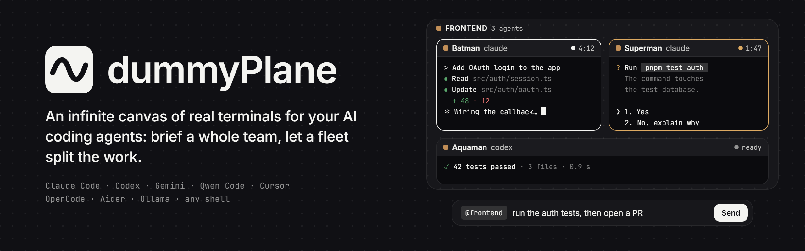

<p align="center">
  <picture>
    <source media="(prefers-color-scheme: light)" srcset="docs/assets/brand/banner-light.png">
    
  </picture>
</p>

<p align="center">
  <a href="LICENSE"></a>
  
  
  
</p>

dummyPlane is a desktop app that puts your AI coding agents on an infinite canvas. Each agent runs in a **real terminal** (Claude Code, Codex, Gemini CLI and more). You group agents into teams, brief a whole team in one line, review their changes, and hand a large task to the **fleet**, which plans it with you, then hands it to a Kanban board and a Manager that runs the team while you keep talking.

Everything runs on your machine. dummyPlane adds no cloud service and no telemetry, and it never skips an agent's permission prompts. Its only request of its own is a check for updates, which you can turn off.

If you know Symvibe, dummyPlane covers the same ground (driving a fleet of CLI agents from an infinite canvas) as an independent, open-source project with its own design and features.

> [!NOTE]
> dummyPlane is an early preview, built and tested on **Windows 10/11**. Its interface is in **English**; the light and dark themes follow Windows.

## Contents

- [Features](#features)
- [A tour](#a-tour)
- [The Fleet](#the-fleet)
- [Supported agents](#supported-agents)
- [Keyboard](#keyboard)
- [Install](#install)
- [How it works](#how-it-works)
- [Contributing](#contributing)
- [License and credits](#license-and-credits)

## Features

- **Real terminals on a canvas.** Every agent is a real PTY (ConPTY on Windows) drawn with xterm.js. You can pan, zoom, draw around the agents and annotate their work. The canvas is [Excalidraw](https://github.com/excalidraw/excalidraw), so shapes, arrows, text and images all work.
- **Teams.** Compose a group with a role (Frontend, Backend, Testers, Reviewers…). Each group takes its names from a pantheon (DC, Marvel, Throne of Glass, Star Wars or Lord of the Rings): Batman, Thor, Aelin…, picked when you compose the group or later from its menu.
  - Give a group a **speciality** (one line, from its menu): a linked fleet reads it to hand each sub-task to the right group.
  - **Fold** a group onto its label with the chevron: its terminals leave the screen, nothing stops, and the label keeps its counters. Going to one of its agents unfolds it; a group can't be folded while its agents are still starting.
  - Save the team on screen as a **preset** (*Save the team as a preset…* in the function palette) and deploy it in any project with *Deploy team: <preset name>*. A preset keeps the shape only: groups, roles, specialities, agents and links, never instructions or history.
- **Live states.** dummyPlane shows whether each agent is starting, ready, running, waiting for you, stopped or done, both on the canvas and in the Agents panel. For Claude Code the state comes from its hooks; for other agents, from their output.
- **Back at the shell.** When Claude Code exits, its terminal stays open at the shell, reads *Agent exited* and offers to resume the conversation. Typing `claude` there yourself (`claude --resume`, `claude -c`…) starts it again as that terminal's agent, with its hooks, tools, role and limits, in PowerShell, pwsh, cmd and Git Bash.
- **One instruction box for everyone.** Address `@all` (everyone), a group, an agent, or several at once (`@batman/superman`). A line starting with `/` goes to the agents' CLI as a command, and dummyPlane suggests Claude Code's commands. The history keeps your last 50 instructions per project.
- **A fleet that plans, a Manager that runs it.** Give the fleet a goal. It proposes a plan; at your go-ahead, a Kanban board and a Manager appear beside it. The Manager gives each agent a sub-task on its own git branch and worktree, watches the time budget and merges the results into a mission branch, while the fleet stays free to talk with you. Details are [below](#the-fleet).
- **Change review.** See what an agent changed, either uncommitted or since its base, browse the repository read-only, and click a line to leave a remark. All remarks go back to the agent in one message.
- **Hear about questions.** When an agent waits for you, a notice stays at the bottom left of the window until it stops waiting, and a Windows notification appears if the window is not in focus (switch it off in the settings menu). A click takes you to the agent, and a palette command goes to the next one that waits. dummyPlane also takes you there by itself, one agent at a time and oldest first, never while you are typing (or for 10 s after the last key while a field holds a draft you have not sent), or in the middle of a dialog or a menu, and not while you answer another agent (switch it off in the settings menu: *Go to agents that ask*).
- **Remote Control.** Turn on Claude Code's Remote Control for one agent, a group or the whole team, and follow them from your phone.
- **Usage at a glance.** The title bar shows your Claude subscription's session and weekly limits. Click it for cost, durations, tokens per model, prompt cache state and an estimate of CO₂.
- **Tokens over 30 days.** From the usage detail, a chart of the tokens you used each day, and their share by agent and by model. dummyPlane reads the logs Claude Code already keeps on your disk, counters only, never the conversations; nothing is sent anywhere. Codex is not read yet.
- **Code Studio.** Fix a file by hand without leaving dummyPlane. Each project has a code workspace, an IDE tab beside its canvases, opened from the right rail or the function palette: the repository's tree, files in tabs with syntax colours in both themes, `Ctrl+S`, a Markdown preview, and *Insert* to put the file on a canvas. `Ctrl+P` finds a file, `App.tsx:42` included, and `Ctrl+G` goes to a line. If an agent wrote the file meanwhile, the save is refused and you choose: reload, or overwrite what you saw.
- **Notes.** Notes are Markdown files in `.dummyplane/notes/` of the project, so an agent can read them without dummyPlane. Link them with `[[name]]`, search them, see their backlinks and their graph, and attach notes to a group. A read-only tool lets agents list and read them.
- **Install an agent from the app.** For an agent that is not found, *Install* shows the official command in full, then runs it in a visible terminal on the canvas that you can interrupt. Ollama models install the same way. Nothing is fetched or run in the background.
- **Loops.** Send an instruction again and again, with brakes. A loop fires every N minutes, when an agent goes idle, or when its screen shows a text; it must end after a number of turns (up to 1000) or a duration (up to 24 hours), whichever comes first. It never writes to an agent that waits for you, is stopped or is starting. A pill at the bottom left counts the running loops and their turns, with *Stop all* one click away, and every loop is off again after a restart. Three templates (progress report, relaunch, watch the tests) fill the form but start nothing.
- **Several Claude accounts.** A profile is only a name and a folder (Claude Code's `CLAUDE_CONFIG_DIR`). *Claude accounts…* in the function palette lists them: *Use* makes one the account of the next Claude agents, *Log in* opens a visible terminal to sign in, *Remove* forgets a profile and leaves its folder alone. A terminal keeps the account it started with, and shows it in its header. dummyPlane never reads, copies or stores a credential.
- **A git window.** Click the branch chip at the bottom left: the files changed in the project, their diff, a tick per file to commit exactly those, the history, and a *Push* button that names its target (`Push 3 → origin/main`). Discarding a file asks first and says what is lost; this button is the only route to a push inside dummyPlane's own tools: it goes only when you click, and it never forces. An agent running commands in a terminal is limited only by its permissions.
- **Overnight run.** Say how long you will be away: the fleet plans, a team works through a queue of tickets, and a morning report waits for you. See [Overnight run](#overnight-run), and read its warnings first.
- **Projects and workspaces.** One project per folder, several workspace tabs per project; drag the tabs to reorder them (or `Alt+←` / `Alt+→` on a tab, or its menu), and the order is remembered. dummyPlane saves everything locally and, after a restart, offers to resume your Claude conversations.
- **Keyboard first.** Use the palettes, jump between terminals, or right-press anywhere for the radial menu. Light and dark themes follow Windows.

## A tour

**Brief the whole team.** Type `@frontend` and the question. The three agents of the group work at the same time, then come back *ready*.

**Send a command to every agent.** After the targets, `/` lists Claude Code's commands; `/context` then runs in each session of the group.

**Review a change and send it back.** Jump to an agent with `Ctrl+P`, open *Review changes* from `Ctrl+Shift+P`, then click a line to leave a remark. *Send to Batman* sends every remark in one message.

**Check your usage.** The meter in the title bar opens the detail: subscription limits and when they reset, cost and durations of dummyPlane's sessions, tokens per model, and each session's prompt cache.

## The Fleet

The fleet is a Claude Code or Codex session that plans a mission with you, then babysits it (*Fleet agent…* in the settings menu: its Manager and its team run on the same CLI). Link one to a group from the group menu (*Link a fleet*) and describe the goal in its terminal. Then:

1. **It proposes a plan.** It splits the goal into sub-tasks, each with an owner, a time budget and, optionally, a difficulty level. The plan appears in the mission panel under the fleet.
2. **You launch the mission.** dummyPlane creates the mission branch `dummyplane/<mission>`, plus a branch and a worktree for each agent next to your repository. Then dummyPlane itself, not the fleet's model, sets the mission up: a **Kanban board** right of the fleet, one card per sub-task in its to-do column, and a **Manager** terminal under the board. The new agents open as the Manager's sub-agents, in a tree that grows downward under it, four to a row. A mission planned from a Kanban column (*Plan with the fleet*) runs on that board instead of a new one.
3. **The Manager runs the board.** It gives every agent its sub-task, reads their reports, merges, reassigns and finishes. The cards follow: *In progress* when an agent takes one, *Done* on its report, *Blocked* when it is blocked or failed. Each agent declares its steps, which appear as a timeline under its terminal, and agents can hand parts of their work to their own sub-agents.
4. **You keep talking to the fleet.** The team never interrupts it: reports, questions and progress go to the Manager and the board. Ask for more and the fleet adds cards, which the Manager's queue starts as soon as a seat frees up; the fleet can also reorder them, look at the board and the team, or stop the mission. It hears two things only: the board is finished (with its summary), or the Manager is stuck and needs you.
5. **The Manager keeps time.** It is told when a sub-task reaches its budget. At twice the budget you get a notification and a red bar. Nobody is stopped automatically: the Manager can extend, interrupt or reassign.
6. **It merges.** Finished branches are merged into the mission branch; a conflict aborts that merge and is reported. A mission's own steps **never push** and **never merge into your own branch**. The git window pushes only when you click *Push*, and an agent running commands in a terminal is limited only by its permissions.

Fleet, board, Manager and team are joined by wires, and *Arrange* moves them as one block. When one agent messages another through dummyPlane (a `message_agent`, the Manager's `write`, a report, a card handed from the fleet to the board to the Manager), a dashed wire forms between them if none was there, and lights up with every message. A mission's agents and their Manager reach each other without a manual link. The mission panel says who runs the mission, with the Manager and the board a click away. Only the mission's end alerts you, once: neither the Manager nor its team do.

With the **model router**, each sub-task's level picks the model its agent runs on:

| Level | Model |
|---|---|
| `low` | Claude Haiku 5.5 |
| `medium` | Claude Sonnet 5.5 |
| `high` | Claude Opus 5.5 |
| `extreme` | Claude Fable 5.1 |

The fleet and the Manager talk to dummyPlane through a local MCP server. The fleet plans with `propose_plan` and babysits with `add_tasks`, `prioritize`, `board`, `team`, `stop_mission` and `remote_control`; the Manager runs the team with `team`, `read_output`, `write`, `extend`, `interrupt`, `reassign`, `merge`, `move_card`, `finish` and `need_user`. Both can read the repository, but they are denied `Edit`, `Write`, `NotebookEdit` and `Bash`: the agents write the code. A Codex fleet and its Manager run in Codex's read-only sandbox with approvals off, and get none of your own MCP servers, plugins or browser tools; `remote_control` is Claude's only. A mission launched before the Manager existed is run to its end by its fleet, the old way.

### Overnight run

Before you leave, open *Overnight run…* in the mission panel: how long you will be away, how many agents, where the tickets come from (GitHub issues with a label, `BACKLOG.md`, or Linear issues of one team with a label), what agents may do unasked and whether the plan waits for you. Until the team is formed, the night's choices stay in the panel, where *Edit…* changes them and *Cancel the night* calls it off. The fleet plans, and the Manager and its team work through a queue: when an agent reports done, its branch is merged into the mission branch and a new agent takes the next task in a new terminal, so each task starts with a fresh context. When you are back, a morning report in the panel gives what is done, what failed, what to check by hand and the time spent. Kanban is not a source yet. The PC stays awake during the mission, but closing the lid or asking for sleep still puts it to sleep.

Read this before you choose:

- **By default the plan waits for your go-ahead and agents may *Edit files*.** They edit files and run simple file commands (`mkdir`, `mv`, `cp`) unasked, and stop at their first other command until you are back. That is the safer choice, and it limits what a night can do.
- ***Edit files and run commands* is an explicit choice.** Agents run any command unasked, and what would still ask is refused: the network and the accounts logged in on this PC are open to them. Use a repository you can afford to lose.
- **The fleet and its Manager never wait for a yes at night.** The fleet's session restarts on the same conversation in a mode that refuses whatever would ask, and the Manager starts in it; neither can edit files or run commands. *Clean up the mission* puts the fleet back as it was and closes the Manager.
- **Linear is read by the fleet, through Linear's own read-only server** (`https://mcp.linear.app/mcp/readonly`), with no key stored in dummyPlane. Choose *Linear*, then *Connect…*: the fleet restarts with Linear's server, and you sign in once in its terminal with `/mcp` (pick *linear*, then *Authenticate*); a Codex fleet opens Linear's sign-in in your browser instead (`codex mcp login`). dummyPlane cannot see that sign-in: if the fleet finds no Linear tool at night, it says so and plans nothing.
- **The push block is not a security boundary.** `git push` and the `gh` commands that reach the remote are denied by rules on the command's text and by a git setting in the terminal. They stop accidents. An agent running commands can get past them: a review did with `-c remote.origin.pushurl` and `GIT_CONFIG_COUNT=0`.

## Supported agents

dummyPlane launches the agents you already have installed: an agent counts as available when its command is on your `PATH`.

| Agent | Command | State detection |
|---|---|---|
| Claude Code | `claude` | Hooks (precise: running, waiting for you, done) |
| Codex | `codex` | Output, plus its `notify` hook at the end of each turn; it gets dummyPlane's tools through a profile in `$CODEX_HOME`, removed when its terminal closes |
| Gemini CLI | `gemini` | Output |
| Qwen Code | `qwen` | Output |
| Cursor | `cursor-agent` | Output |
| OpenCode | `opencode` | Output |
| Aider | `aider` | Output |
| Ollama | `ollama run <model>` (or Aider on an Ollama model) | Output |
| Shell | PowerShell, cmd, pwsh or Git Bash | Output |
| Custom | any command you type | Output |

Remote Control, missions, the model router, the step timeline and the usage meter rely on Claude Code; the canvas, groups, mentions and review work with every agent.

## Keyboard

| Shortcut | Action |
|---|---|
| `Ctrl+P` | Go to a terminal, group, fleet, workspace or project |
| `Ctrl+Shift+P` | Function palette (every command of the app) |
| `Ctrl+Tab` / `Ctrl+Shift+Tab` | Next / previous terminal, in reading order |
| `Shift+Esc` | Give the keyboard back to the canvas |
| `Ctrl+Shift+A` | Overview |
| Right-press | Radial menu: click an item, or hold, drag and release |
| `@` · `/` · `↑` | In the instruction box: target · command · history |
| `Shift+Enter` | New line, in the instruction box and in terminals |

Excalidraw's own keys (`V`, `H`, `R`, `O`, `A`, `T`, `P`, `E`, `Ctrl+Z`…) work whenever the canvas has the keyboard. In a terminal, `Ctrl+C` copies when text is selected and interrupts otherwise.

## Install

Download `dummyPlane_<version>_x64-setup.exe` from the [latest release](https://github.com/MullaAhmed/dummyPlane/releases/latest) and run it (Windows 10/11). It installs for your user only and needs no administrator rights.

You also need at least one agent CLI, for example [Claude Code](https://docs.claude.com/en/docs/claude-code/overview), and [Git](https://git-scm.com/): Git Bash provides the `bash` that the usage meter needs.

> [!IMPORTANT]
> Betas are not code-signed yet. If Windows SmartScreen stops the installer, choose **More info**, then **Run anyway**.

On first launch, the home screen walks you through installing an agent, adding a project and launching an agent. Something wrong? See the [troubleshooting guide](docs/troubleshooting.md), or open **Troubleshooting** from the settings menu.

**Updates.** dummyPlane looks for a new release on GitHub 10 seconds after it starts, then every 6 hours, and offers to install it. Before the installer restarts it, dummyPlane saves your canvas and the terminals' history; Claude conversations can be resumed afterwards. Updates are signed: one whose signature does not match is refused. This check is the only request dummyPlane makes on its own. To turn it off, open the settings menu (the gear) and untick **Rechercher les mises à jour automatiquement**.

dummyPlane runs once: launching it a second time brings the open window back (and restores it if it was minimized) instead of starting another copy, which would fight the first over the database and the log.

### Build from source

**Prerequisites** (Windows 10/11):

- [Tauri 2's Windows prerequisites](https://v2.tauri.app/start/prerequisites/): the Microsoft C++ Build Tools and WebView2. WebView2 is already present on Windows 11.
- [Rust](https://rustup.rs/) 1.85 or newer (the crate uses edition 2024).
- [Node.js](https://nodejs.org/) 22 LTS and [pnpm](https://pnpm.io/) 10.
- [Git](https://git-scm.com/). Git Bash also provides the `bash` that the usage meter needs.
- At least one agent CLI, for example [Claude Code](https://docs.claude.com/en/docs/claude-code/overview).

**Build and run:**

```powershell
git clone https://github.com/MullaAhmed/dummyPlane.git
cd dummyPlane
pnpm install
pnpm tauri dev                  # run in development
pnpm tauri build                # build the installer
```

The installer is written to `src-tauri/target/release/bundle/nsis/`. It installs per user and needs no administrator rights.

> [!TIP]
> To try dummyPlane without touching your saved projects, give the development build its own data folder:
> `pnpm tauri dev --config '{"identifier":"dev.dummyplane.probe"}'`

## How it works

- **Desktop shell:** [Tauri 2](https://v2.tauri.app/). The Rust side owns the PTYs ([portable-pty](https://crates.io/crates/portable-pty)), git, the SQLite database and a small HTTP server.
- **Interface:** React 19, TypeScript, Zustand and Tailwind CSS 4, with [Excalidraw](https://github.com/excalidraw/excalidraw) for the canvas and [xterm.js](https://xtermjs.org/) for the terminals.
- **Agent states and tools:** the HTTP server listens on `127.0.0.1` only, on a random port.
  - Each Claude Code session gets an extra `--settings` file. It declares hooks that report the session's state, a status line that reports usage, and an MCP server for the mission tools.
  - Every request needs a token drawn when the app starts, or a token for the session itself.
  - dummyPlane reads your own `~/.claude/settings.json` but never modifies it, and your own status line keeps showing in the terminals.
- **Storage:** projects, canvases, terminal scrollback and settings live in a local SQLite database under `%APPDATA%\dev.dummyplane.app\`. Notes are plain files in the project's `.dummyplane/notes/`; team presets are a setting of the database.
- **Token counts:** read-only and bounded. dummyPlane scans the `.jsonl` logs under Claude Code's folder (`~/.claude/projects`, or `$CLAUDE_CONFIG_DIR`) for the last 30 days, keeps dates, models and counters, and drops the rest unread.

See [SECURITY.md](SECURITY.md) for the security model in more detail.

## Contributing

Bug reports, ideas and pull requests are welcome, in English or in French. Start with [CONTRIBUTING.md](CONTRIBUTING.md); the ideas already in line are in [BACKLOG.md](BACKLOG.md). Please follow the [Code of Conduct](CODE_OF_CONDUCT.md).

## License and credits

dummyPlane is released under the [MIT License](LICENSE).

dummyPlane is a fork of [OpenVibe](https://github.com/Mideky-hub/openvibe) (MIT, © Mathieu Kerbel), which this project continues at [MullaAhmed/dummyPlane](https://github.com/MullaAhmed/dummyPlane). Thanks to Mathieu Kerbel and the OpenVibe contributors for the original work; the upstream copyright notice is kept in the [LICENSE](LICENSE).

It builds on [Tauri](https://tauri.app/), [Excalidraw](https://github.com/excalidraw/excalidraw), [xterm.js](https://xtermjs.org/), [portable-pty](https://github.com/wezterm/wezterm/tree/main/pty) and [cmdk](https://cmdk.paco.me/).
dummyPlane is an independent project. It is not affiliated with Symvibe, Anthropic, OpenAI, Google or the makers of the other agents it launches; their names belong to their owners.
